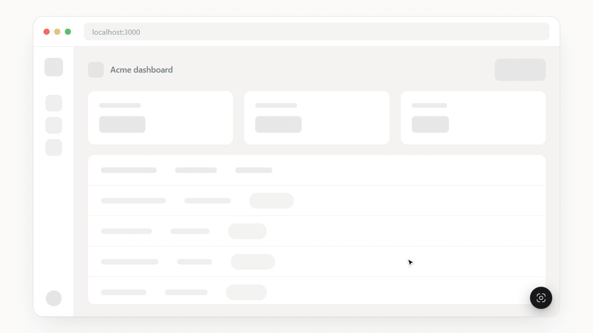

# PixelSpec

**Figma-style inspect and spacing overlay for any website, with AI-ready feedback.**

[](https://github.com/yesith0106/pixelspec/actions/workflows/ci.yml)
[](LICENSE)

PixelSpec lets you measure spacing between elements right in the browser: padding, margin, gaps, distances, letter spacing, line height, colors and contrast, like Figma's inspect panel on top of the live page. Click any element to leave feedback, then copy it all as a compact prompt for your AI coding agent. It is an open-source [agentation](https://agentation.com) alternative with built-in design inspection.



- Works on any site and any framework. React, Vue and Svelte component names are detected automatically.
- Zero runtime dependencies. The overlay lives in a shadow root, so it never touches your styles.
- One file for a plain `<script>` tag, or an npm package with a React component.

## Quick start

Pick the setup that matches your project. All three take under a minute.

### React or Next.js

```bash
npm install -D github:yesith0106/pixelspec
```

```tsx
import { PixelSpec } from 'pixelspec/react';

export default function App() {
  return (
    <>
      <YourApp />
      {process.env.NODE_ENV === 'development' && <PixelSpec />}
    </>
  );
}
```

In the Next.js App Router, render it from a `'use client'` component, for example in your root layout.

### Vite, Vue, Svelte or any bundler

```bash
npm install -D github:yesith0106/pixelspec
```

```ts
// main.ts
if (import.meta.env.DEV) {
  import('pixelspec').then(({ init }) => init());
}
```

### Plain HTML, no build step

1. Download `pixelspec.global.js` from the [latest release](https://github.com/yesith0106/pixelspec/releases/latest).
2. Put it next to your page and add one line before `</body>`:

```html
<script src="pixelspec.global.js"></script>
```

Optional attributes: `data-active="true"` to start open, `data-hotkey="alt+shift+i"`, `data-position="bottom-left"` and `data-ai-detail="full"`.

**Then open your page.** Click the round button in the bottom-right corner, or press <kbd>Alt</kbd>+<kbd>Shift</kbd>+<kbd>I</kbd>.

## How to use it

1. **Hover** anything to see its name and size.
2. **Click** an element. A popover opens where you clicked, with the key specs: size, padding, margin, gap, layout, font, color, contrast, radius and shadow. Click any value to copy it. The spacing icons use the overlay colors: green is padding, orange is margin, pink is gap.
3. **Hover another element** to see red redline distances, like Figma. Hold <kbd>Alt</kbd> to measure to the parent.
4. **Type feedback** and press <kbd>Enter</kbd>. A numbered marker appears on the element. Hover a marker to read the note, click it to edit or delete.
5. **Select text** on the page to leave feedback that quotes it.
6. **Copy** with the toolbar's copy button or <kbd>C</kbd>, and paste it into your agent.

In the popover header, click the element name to copy its selector, or the code icon to copy its CSS. "All properties" opens the full list: box model, every flex and grid property, full typography, colors, appearance, accessibility and attributes.

### Toolbar

The toolbar can be dragged anywhere, and it remembers where you put it.

| Button | Key | What it does |
| --- | --- | --- |
| Spacing overlay | <kbd>S</kbd> | Box model and pink gap hatching on the selected element |
| Guides | <kbd>G</kbd> | Crosshair with coordinates and edge guides |
| Pause animations | <kbd>P</kbd> | Freezes CSS animations, transitions and videos |
| Hide markers | <kbd>H</kbd> | Shown once you have feedback |
| Copy feedback | <kbd>C</kbd> | Copies all feedback. The badge shows the count |
| Clear all | <kbd>X</kbd> | Clears all feedback, with Undo |
| Settings | | Copy detail, overlays, clear after copy |
| Close | <kbd>Esc</kbd> | Esc closes the popover first, then the toolbar |

In the popover, <kbd>↑</kbd> <kbd>↓</kbd> <kbd>←</kbd> <kbd>→</kbd> walk to the parent, child and siblings while the feedback box is empty. <kbd>Shift</kbd>+<kbd>Enter</kbd> adds a new line.

Your work is protected. A stray click never throws away feedback you are typing; the popover shakes instead. Deleting and clearing can be undone. Feedback survives page reloads and hot reloads.

While the toolbar is open, clicks on the page are blocked so links and buttons don't fire. Text selection still works.

## Copy for AI

Copied feedback uses a compact format by default to save tokens. It has two lines per element and only non-default values:

```
Make this button bigger
body>header>button.cta "Start free trial"
126×34 p:10 18 r:999 | system-ui 14/14 w600 ls:0.01em | c:#FFF bg:#3581F6 contrast:3.7(fails AA)
```

Key: `p` padding, `m` margin, `b` border, `r` radius, `14/14 w600` size/line-height and weight, `ls` letter spacing, `c` text color, `bg` background. Contrast only appears when it fails AA. Containers skip text and typography.

For the full Markdown version, switch to Full in settings, hold <kbd>Shift</kbd> while copying, or set `aiDetail: 'full'`. It adds page position, layout details, shadows and the full contrast result, at roughly 2.5 times the length.

## Options

```ts
init({
  hotkey: 'alt+shift+i',        // modifiers: alt, shift, ctrl, meta, mod (Ctrl or ⌘)
  startActive: false,
  showToolbar: true,
  position: 'bottom-right',     // or 'bottom-left'
  aiDetail: 'compact',          // starting value; users can change it in settings
  persist: true,                // remember settings, toolbar position and feedback
  onCopy: (text, kind) => {},   // kind: 'value' | 'css' | 'ai' | 'selector' | 'notes'
});
```

The React component takes the same options as props, plus `enabled`. The instance returned by `init()` has `activate()`, `deactivate()`, `toggle()`, `select(el)`, `getNotes()`, `notesMarkdown()` and `destroy()`.

## Known limits

- Contrast ignores background images and element opacity, and says so in the popover.
- Feedback is matched back to elements by selector after a reload, so it can land on the wrong element if the page structure changed.
- Rendered font detection is a heuristic based on loaded font faces and canvas measurement.
- Component source paths need a dev build. React 19 removed `_debugSource`, so React 19 shows names only.
- Elements inside closed shadow roots and cross-origin iframes can't be inspected.

## Contributing

Contributions are welcome. See [CONTRIBUTING.md](CONTRIBUTING.md) for how to run it locally and how the code is laid out.

```bash
git clone https://github.com/yesith0106/pixelspec.git
cd pixelspec
npm install
npm run demo      # http://localhost:5178/demo/
```

## License

[MIT](LICENSE). Icons are from the free [Hugeicons](https://hugeicons.com) set, also MIT, and only the icons in use are bundled.
